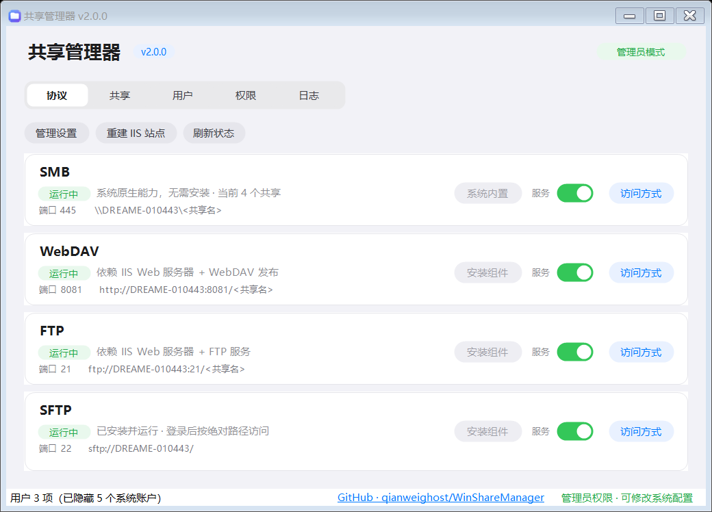

# WinShareManager

[](https://github.com/qianweighost/WinShareManager/releases/latest)
[](LICENSE)
[](#)
[](https://github.com/qianweighost/WinShareManager/releases/latest)

Windows 上的原生共享协议统一管理台。一个界面管理 **SMB / WebDAV / FTP / SFTP** 四种协议，统一用户密码、共享目录与目录权限。

> 仓库：<https://github.com/qianweighost/WinShareManager>

## 下载

到 [Releases](https://github.com/qianweighost/WinShareManager/releases/latest) 下载 `WinShareManager.exe`，**单文件、双击即用**，不需要安装、不需要 .NET SDK、不联网。

- 体积约 310 KB，全部代码与图标内嵌
- 启动会请求管理员权限（UAC），这是修改共享 / 服务 / 防火墙所必需的
- 仅支持 Windows 10 / 11（x64）



---

## 为什么不是买个现成软件

查证结果是：Windows 上**不存在**同时做这四种协议服务端的成品软件。

| 产品 | 缺什么 |
|---|---|
| Wing FTP Server | 官方论坛明确回复：不支持 WebDAV |
| Serv-U 15.x | 协议只有 FTP / FTPS / SFTP / HTTP / HTTPS，无 WebDAV |
| CrushFTP | 官网 SMB/SMB1/SMB3 指的是 VFS 后端（连别人的共享），不是自己当 SMB 服务端 |

根本原因：Windows 的 SMB 服务端跑在内核态（`srv2.sys`），任何用户态程序都无法接管它。

所以本工具的架构是 **复用 Windows 原生四件套 + 一层统一图形界面**：

```
                    ┌─────────────────────────┐
                    │   WinShareManager GUI   │
                    │  用户 / 共享 / 权限 统一  │
                    └───────────┬─────────────┘
                                │
        ┌───────────┬───────────┼───────────┬───────────┐
        ▼           ▼           ▼           ▼           ▼
    New-SmbShare  IIS WebDAV  IIS FTP   OpenSSH    icacls
      SMB 445     HTTP 8081   FTP 21   SFTP 22    NTFS ACL
        └───────────┴───────────┴───────────┴───────────┘
                                │
                  同一套 Windows 本地账户 + NTFS 权限
```

四种协议共用同一套账户和 ACL —— 加一个用户，四种协议同时生效；改一次目录权限，四种协议同时受限。这是唯一能做到真正统一权限的 Windows 架构。

---

## 文件清单

### 交付物（拿这一个文件就够）

| 文件 | 作用 |
|---|---|
| **`WinShareManager.exe`** | **真·单文件程序，双击即用**（约 308 KB，全部代码 + 图标内嵌，清单里直接请求管理员权限，无控制台黑框，标题栏 / 任务栏 / Alt-Tab 三处图标一致） |

`WinShareManager.exe` 不依赖任何外部文件、不联网、不解压到临时目录，拷到任何 Windows 10/11 机器上双击就能跑。

### 源码（想改才需要）

| 文件 | 作用 |
|---|---|
| `ShareManager.Core.ps1` | 逻辑层：配置、组件安装、共享、用户、权限、协议启停（无界面代码） |
| `App.UI.ps1` | 界面层：类苹果风格窗口、五个页面、全部交互 |
| `build.ps1` | 构建脚本：合并上面两个文件 → 生成图标 → 注入图标 → 编译成单文件 exe |
| `WinShareManager.ps1` | 构建产物：合并后的单文件脚本（可直接用 powershell 运行，作为 exe 的备用形态） |
| `app.ico` | 构建时生成的应用图标（蓝→紫渐变 squircle + 白色文件夹；16 / 32 / 48 / 64 用 DIB 帧、256 用 PNG 帧） |

运行时数据保存在：

```
C:\ProgramData\WinShareManager\config.json       配置（共享根目录、端口、已登记共享）
C:\ProgramData\WinShareManager\ops.log           操作日志
C:\ProgramData\WinShareManager\last-report.txt   最近一次 -Check 体检报告
```

> 单文件版不再需要 `launch.ps1`、`启动管理器.cmd` 和 IExpress 自解压包 —— 提权由 exe 清单负责，不再有多级进程，任务栏只会有一个图标。

---

## 界面

类苹果风格（iOS 系统色 + 圆角卡片 + 胶囊按钮与分段导航），窗口内五个页面用顶部分段控件切换：

| 页面 | 内容 |
|---|---|
| 协议 | 四个协议各一张卡片，独立安装 / 滑块开关启停 / 访问方式说明 |
| 共享 | 按共享名分组列出各协议，一键复制链接、单协议删除 |
| 用户 | 本地账户新建 / 改密 / 启停 / 删除 |
| 权限 | 共享 + 用户 + 权限级别 → NTFS ACL，并以中文列出当前目录生效授权 |
| 日志 | 运行日志与每次操作的实时回溯 |

配色取值：背景 `#F2F2F7`、卡片白、强调色 `#007AFF`、成功 `#24A84A`、危险 `#FF3B30`、分隔线 `#E5E5EA`。

胶囊按钮、状态徽章、分段导航、**滑块开关**全部是**自绘**：先用表面色铺满控件，再抗锯齿填充圆角路径，最后用
`TextRenderer` 画文字。没有用 `Control.Region` 裁剪 —— Region 是按像素做的 1 位遮罩，没有抗锯齿，
胶囊两端会出现毛边。

应用图标是蓝→紫渐变 squircle + 白色文件夹剪影，`app.ico` 里 256 / 64 / 48 / 32 / 16 五个尺寸
**各自矢量绘制一次**（不是把 256 缩下去），所以任务栏的小图标不糊。

窗口右上角会显示当前是否以管理员身份运行 —— 非管理员时程序仍可打开，但安装组件与改配置会被拦下并提示。

---

## 「协议」页：一个协议一张卡

四种协议各自独立一栏，互不影响。每栏都有 **安装组件 / 启动开关 / 访问方式** 三组控件和实时状态：

| 协议 | 安装按钮装什么 | 滑块开关控制什么 |
|---|---|---|
| SMB | 无需安装（系统原生，按钮显示"系统内置"并禁用） | LanmanServer 服务 |
| WebDAV | IIS Web + IIS WebDAV 发布 | 只启停 `WSS-WebDAV` 站点，**不影响 FTP** |
| FTP | IIS Web + IIS FTP 服务 | 只启停 `WSS-FTP` 站点，**不影响 WebDAV** |
| SFTP | OpenSSH Server | sshd 服务 |

启停是一个**滑块开关**而不是两个按钮：开着是绿色轨道 + 滑钮靠右，关着是灰色轨道 + 滑钮靠左，
组件没装时整块置灰拨不动。实现是 `New-Toggle` 自绘（轨道圆角 + 白色滑钮），状态存在控件的 `Tag` 哈希表里，
和 `Enable-RoundSurface` 一样走 Paint 事件，不依赖 `Control.Region` 所以边缘是抗锯齿的。

WebDAV 和 FTP 的启停走的是「站点级」开关而不是「服务级」，所以停掉一个不会把另一个连带停掉。

每张卡还会显示：状态文字（运行中 / 已停止 / 未安装，带颜色）、依赖说明、端口与访问地址。

### 安装组件不会再把界面卡死

`Add-WindowsCapability`、`appcmd`、`New-SmbShare` 这些调用动辄几十秒到几分钟，占住 UI 线程期间
Windows 就会给窗口挂上「未响应」。现在的做法是**把长任务交给自己的子进程跑**：

```
父进程（界面） --启动--> 子进程 WinShareManager.exe -Task InstallProtocol -TaskArg SFTP
      |                              |
      +-- 每 180ms 轮询一次 ----------+  （消息泵一直是活的，窗口可以拖动、可以响应）
      +-- 实时 tail ops.log 显示在同一日志文件里
```

- 子进程入口是脚本开头的 `零、后台任务入口`，支持 `InstallProtocol` / `RemoveShareProtocol` / `RebuildSites`
- 弹窗里有自绘的细进度条、实时滚动的日志、退出码结果；点「转到后台」可以关掉弹窗让任务继续跑
- 用 ps1 方式运行时子进程是 `powershell -File 脚本 -Task ...`，用 exe 运行时子进程就是 exe 自己
- 退出码 0 / 1 决定界面显示「安装完成」还是「安装失败」

### OpenSSH 安装失败（0x80070424「指定的服务未安装」）

这个错误码极具误导性：缺的**不是 sshd**，而是 DISM 背后的 Windows Update 服务 `wuauserv`。
系统精简 / 优化工具常把它的服务注册删空（注册表键还在，但 `ImagePath`、`ServiceDll` 全为空，
`Get-Service wuauserv` 直接查不到），于是下载组件包的链路断掉。

现在安装前会先探测，探测到不可用就**不再白等几十秒**，直接在日志里给出三条可执行方案：

1. **方案 A（推荐，不动系统服务）**：下载 `OpenSSH-Win64.zip`，把解压出的文件夹放到
   `C:\Program Files\OpenSSH\`，再点一次「安装组件」——程序会自动找到 `sshd.exe` 并注册服务。
   查找顺序：`System32\OpenSSH` → `Program Files\OpenSSH` → `Program Files\OpenSSH-Win64` →
   `C:\OpenSSH` → `ProgramData\WinShareManager\OpenSSH`
2. **方案 B（恢复在线安装能力）**：管理员执行 `sc create wuauserv ...` + 写回 `ServiceDll` + `net start wuauserv`
3. **方案 C**：设置 → 应用 → 可选功能 → 添加功能 → 「OpenSSH 服务器」（同样依赖 Windows Update）

以上三条都不需要用户自己动手：**程序会先尝试自动下载便携版**（`releases/latest/download/OpenSSH-Win64.zip`，
拿不到直链再用 GitHub API 找资产地址），解压到 `C:\Program Files\OpenSSH\` 继续下面的流程。

### 服务注册成功但「启动后立即退出」（7034）

这是 SFTP 最容易踩的一个坑，事件日志里只有一句毫无信息量的「服务 OpenSSH SSH Server 意外停止」，
`sshd -t` 还显示配置完全正常。真正的原因有三个，按出现频率排序：

| 原因 | sshd 的真实反应 | 对策 |
|---|---|---|
| **主机私钥权限过宽** | 每把密钥都打 `WARNING: UNPROTECTED PRIVATE KEY FILE!`，全部忽略后 `no hostkeys available -- exiting` | 逐文件断开继承，只留 `SYSTEM` + `Administrators` |
| 缺 `sshd_config` | 启动即退出，无日志 | 从 `sshd_config_default` 复制，缺失则写最小可用配置 |
| 缺服务特权 | 无法为登录用户创建令牌 | 写 `RequiredPrivileges`（见下） |

**私钥权限为什么会天然过宽**：`%ProgramData%\ssh` 默认把 `Authenticated Users:读取` 继承给所有子文件，
所以 `ssh-keygen -A` 刚生成出来的四把私钥就已经是「其他人可读」的状态了。必须逐文件
`SetAccessRuleProtection($true, $false)` + 清空 ACE + 只加 SYSTEM / Administrators / Owner=Administrators。

**服务特权**：官方 `install-sshd.ps1` 里有一行 `sc privs sshd SeAssignPrimaryTokenPrivilege/SeTcbPrivilege/...`，
它写的是 `HKLM\SYSTEM\CurrentControlSet\Services\sshd\RequiredPrivileges`。LocalSystem 服务的默认特权集
**不含** `SeAssignPrimaryTokenPrivilege` / `SeTcbPrivilege`，缺了它 sshd 无法为登录用户创建令牌。
本程序直接写注册表（`REG_MULTI_SZ`），等价于 `sc privs` 且不依赖 `sc.exe`。

完整的初始化链路在 `Initialize-OpenSshRuntime`：建 `sshd_config` → `ssh-keygen -A` →
`Repair-SshHostKeyPermission` 收紧私钥 → 写 `RequiredPrivileges` → 加系统 PATH。
`Install-OpenSshServer` 在注册/设定服务之后**必定**调用它，所以「服务在但起不来」的存量故障
点一次「安装组件」就能自动修复。

启动仍然失败时，日志会直接贴出 `C:\ProgramData\ssh\logs\sshd.log` 的末尾几行，并列出三个常见原因。

### 「访问方式」指导

每张卡右侧的 **访问方式** 会弹出一个按协议定制的说明书，不用去翻文档就知道客户端那边该怎么连：

| 区块 | 内容 |
|---|---|
| 服务地址 | 当前协议的完整地址模板（`<共享名>` 占位），只读，右边一键 **复制地址** |
| 按平台分步 | Windows / macOS / 手机·电视盒子 各自 2-3 步，编号列出点哪里、填什么 |
| 提示 | 该协议特有的坑（WebDAV 要 `net start WebClient`、FTP 明文传输、SFTP 无法 Chroot 等） |

四个协议的步骤文案集中放在 `App.UI.ps1` 的 `$script:Guides` 哈希表里，要改措辞只动那一处。

### 页面顶部工具条

三个全局动作，与具体协议无关：

| 按钮 | 作用 |
|---|---|
| 管理设置 | 改共享根目录、WebDAV 端口、FTP 端口 |
| 重建 IIS 站点 | 按当前配置删除并重建 WebDAV / FTP 站点，并重新挂载所有共享 |
| 刷新状态 | 重新探测四种协议的安装与运行状态 |

所有操作过程实时写进「日志」页。

---

## 「共享」页

表格列：`共享名 | 物理路径 | 协议 | 链接 | 状态 | 操作`

**按共享名分组，组内每个协议一行。** 四种协议的访问地址格式完全不同（`\\主机\名`、`http://主机:端口/名`、
`ftp://...`、`sftp://...`），挤在同一格里只会被省略号截断；但把共享名和路径在每行都重复一遍又会把表格塞满。
所以做成两层：组首行显示共享名（加粗）与物理路径，后面的协议行只显示协议名，用 `├` `└` `·` 表现层级。

实现上是一个隐藏的 `组首` 布尔列 + `CellFormatting` 事件：非组首行把「共享名 / 物理路径」清空，
同时禁用整表排序（一排序分组就散架）。

| 列 | 说明 |
|---|---|
| 协议 | 该行是哪个协议的访问入口 |
| 链接 | 该协议对应的完整地址，按端口自动生成 |
| 状态 | **已生效** = 协议正在运行且共享已挂载；**协议未运行** = 链接暂时打不开，去「协议」页启动 |
| 复制 | 把这一行的链接复制到剪贴板，结果显示在底部状态栏 |
| 删除 | **只删这一行的协议**，同一共享的其它协议继续可用 |

### 单协议删除 vs 整条删除

两个层级故意分开：

- 行内 **删除** → `Remove-ShareProtocol -Name -Protocol`：只摘掉这一个协议
  （SMB 共享 / WebDAV 虚拟目录 / FTP 虚拟目录；SFTP 因为走绝对路径，只取消登记），
  剩下几个协议照常服务；摘到最后一个时整条记录才一起消失
- 工具条 **删除整条共享** → `Remove-ShareEntry`：一次把该共享名下的全部协议都摘掉

两种操作都**不会删除磁盘上的文件**，确认框里会写明「还剩哪些协议」或「这是最后一个协议」。
删除也走后台任务，因为重建 IIS 需要时间。

改了端口之后点「重建 IIS 站点」，链接列会跟着变。

---

## 「用户」页

列出本机真实会用到的账户。Windows 自带的服务账户和工具产生的沙箱账户（`DefaultAccount`、
`WDAGUtilityAccount`、`CodexSandbox*`、`defaultuser*`、`admin` 等）默认**隐藏**，
否则会把有用的账户淹没掉。

点工具栏 **显示系统账户** 可临时全部显示，按钮会变成「隐藏系统账户」，再点一次收起。
当前隐藏了几个会显示在底部状态栏（例：`用户 3 项（已隐藏 5 个系统账户）`）。

隐藏只是不显示，不影响账户本身，也不会影响「权限」页的下拉列表逻辑（同样跟随该开关）。

---

## 「权限」页：一套 NTFS 授权，四种协议共用

四种协议最终都是靠 NTFS ACL 判权限的，所以这一页是整个工具的核心，也是以前最容易看不懂的一页。

**上半部分是操作**：选共享目录 → 选账户 → 选权限级别（只读 / 读写 / 完全控制）→ 应用或撤销。

账户下拉里除本机账户外，额外提供两个常用组：

| 选项 | 实际写给 icacls 的 | 场景 |
|---|---|---|
| `Everyone（所有人）` | `Everyone` | 让局域网里任何人都能读，不用建账号 |
| `Users（本机用户组）` | `Users` | 让所有本机账户都能读 |

**下半部分是这张表当前真实生效的授权**，以前直接显示 `DREAME-010443\Administrator | FullControl, Synchronize | Allow`
这种原始枚举，没人看得懂。现在做了四层翻译：

| 原始值 | 现在显示 |
|---|---|
| `DREAME-010443\Administrator` | `Administrator`（去掉计算机名前缀） |
| `Everyone` / `Users` / `Authenticated Users` | `所有人（Everyone）` / `本机用户组（Users）` / `已认证用户（Authenticated Users）` |
| `FullControl` / `Modify` / `ReadAndExecute` / `Read` / `Write` | `完全控制` / `修改` / `读取和执行` / `读取` / `写入` |
| `Allow` / `Deny` | `允许` / `拒绝` |

另外两处关键改动：

- **多一列「来源」**：`在此目录设置` 还是 `继承自上级`。用户点了「应用权限」却看不到效果，
  多半是把继承来的条目当成了自己设的条目——现在一眼能分清。
- **过滤噪声**：`SYSTEM`、`管理员组`、`TrustedInstaller`、`CREATOR OWNER` 不列；
  `PropagationFlags` 含 `InheritOnly` 的「仅继承」条目也不列（它们只作用于子目录，对这一层不生效，
  而且 Windows 会把它们显示成 `268435456` 这种数字）。
  过滤掉多少条会写在表头上方的说明里：`另有 N 条系统内置或仅继承的条目未列出`。

细粒度授权（Windows 把权限拆成 `ReadData` / `WriteData` / `ExecuteFile` 等）会按「有没有读 / 有没有写」
折算成 `读取` / `写入` / `修改`，不再满屏「特殊权限」。

---

## 快速开始

1. 双击 `WinShareManager.exe`，UAC 点「是」。
2. 进入「协议」页，对要用的协议点各自的 **安装组件**（例：只用 SMB + SFTP 就装 SFTP 那一栏）。
   安装过程在后台跑，弹窗里有实时日志，窗口不会卡死。
   程序会自动放行对应端口：FTP 21、WebDAV 8081、SFTP 22。
3. 点 **管理设置**，把共享根目录改成你要的位置（可自定义任意路径，不存在会自动创建）。
4. 进入「用户」页，点 **新建用户**，输入用户名和密码（自动加入 Users 组）。
5. 进入「共享」页，点 **新增共享**：选物理路径、填共享名、勾选要发布的协议。
6. 进入「权限」页，选共享 + 用户 + 权限级别，点 **应用权限**。

---

## 各协议的实际行为

| 协议 | 实现方式 | 访问地址 |
|---|---|---|
| SMB | `New-SmbShare`，共享级给 Users 组「更改」权限，最终由 NTFS 收紧 | `\\主机名\共享名` |
| WebDAV | 一个站点（默认 8081）根目录 = 共享根目录，每个共享是虚拟目录 | `http://主机名:8081/共享名` |
| FTP | 一个站点（默认 21）同上 | `ftp://主机名:21/共享名` |
| SFTP | OpenSSH Server，按绝对路径访问 | `sftp://主机名/` |

**为什么 SFTP 不单独建站点**：Windows 版 OpenSSH 不支持 `ChrootDirectory`，登录后固定在用户主目录。所以 SFTP 的可见范围由 NTFS 权限决定 —— 授权哪个目录，就能访问哪个目录，这也正是「统一权限」的一部分。

---

## 权限映射

界面上三个选项对应到底层的 `icacls`：

| 界面选项 | icacls 参数 | 含义 |
|---|---|---|
| 只读 | `(OI)(CI)RX` | 遍历 + 读 + 执行 |
| 读写 | `(OI)(CI)M` | 修改（含删除） |
| 完全控制 | `(OI)(CI)F` | 完全控制 |
| 撤销授权 | `/remove:g` | 移除该账户授权 |

`(OI)(CI)` 表示对象继承 + 容器继承，即对整个子树生效。

---

## 回滚

```powershell
# 删除所有站点、共享、防火墙规则（IIS/OpenSSH 组件本身保留）
.\WinShareManager.exe -Restore

# 只做环境体检，不启动界面、不改任何东西
.\WinShareManager.exe -Check

# 后台任务入口（界面内部用，也可以手动调）
.\WinShareManager.exe -Task InstallProtocol     -TaskArg SFTP
.\WinShareManager.exe -Task RemoveShareProtocol -TaskArg Share1 -TaskArg2 FTP
.\WinShareManager.exe -Task RebuildSites
```

`-Task` 一律无界面执行，退出码 0 = 成功、1 = 失败，过程写进 `ops.log`。

`-Check` 会打印四种协议的状态、已登记共享和本地用户，同时把报告写到 `C:\ProgramData\WinShareManager\last-report.txt`。

彻底还原还需要在「启用或关闭 Windows 功能」里手动关闭 IIS 相关项 —— 这一步故意不自动化，避免误伤其他站点。

---

## 从源码构建

改完 `ShareManager.Core.ps1` 或 `App.UI.ps1` 之后：

```powershell
powershell -NoProfile -ExecutionPolicy Bypass -File build.ps1
```

版本号只有一处：`ShareManager.Core.ps1` 顶部的 `$script:AppVersion`。
`build.ps1` 会解析它并同步给 ps2exe 的 `-version`，界面标题、版本徽标、状态栏、exe 文件属性全部跟着变，发版只改这一行。

构建脚本会依次完成：

1. 剥离 Core 的头部，与界面层拼成单文件脚本 `WinShareManager.ps1`
2. 做语法校验（有错直接中止并打印行号）
3. 生成 `app.ico`（渐变 squircle + 白色文件夹，16/32/48/64/256 各画一次）
4. **把 `app.ico` 转成 base64 注入脚本**（替换占位符 `@@ICON_B64@@`）
5. 用 ps2exe 编译成 `WinShareManager.exe`，参数为 `-requireAdmin -noConsole -STA -UNICODEEncoding -supportOS -x64`

首次构建需要 ps2exe 模块：`Install-Module ps2exe -Scope CurrentUser -Force`。

可选参数：`-SkipExe` 只合并脚本不编译；`-KeepOld` 保留旧 exe 不做备份；`-ForceIcon` 强制重画图标（默认已有 `app.ico` 就跳过）。

### 图标为什么要注入 base64

把图标编进 exe 资源（ps2exe 的 `-iconFile`）只影响**资源管理器里那个文件**的显示。
WinForms 窗体不显式赋值 `$form.Icon` 时，会退回一个通用默认图标，**完全不读 exe 资源**，
于是标题栏、任务栏、Alt-Tab 三处全是「某个普通 Windows 程序」的样子。

所以 `App.UI.ps1` 里留了 `$script:IconB64 = '@@ICON_B64@@'`，由构建脚本在编译前替换成真正的 base64。
运行时 `Get-AppIcon` 的取值优先级是：

1. 注入的 base64（多尺寸，单文件自足）
2. 脚本 / exe 同目录的 `app.ico`（开发时直接跑 ps1）
3. `Icon.ExtractAssociatedIcon(exe)`（兜底）

**ICO 帧的编码方式也有讲究**：≤64 的帧必须写成 **32bpp DIB**（BITMAPINFOHEADER + BGRA + AND 掩码），
只有 256 用 PNG。全用 PNG 的话，Windows 资源管理器能显示，但 GDI+（`System.Drawing.Icon`）
读小尺寸 PNG 帧会失败或畸形——`ToBitmap()` 直接抛「请求的范围扩展超过了数组的结尾」，
标题栏和任务栏图标就会花掉。

### 界面自检（改了界面后建议跑一次）

不需要打开窗口就能验证全部控件与刷新逻辑：

```powershell
$env:WSM_SMOKE = '1'
powershell -NoProfile -ExecutionPolicy Bypass -File WinShareManager.ps1
```

会输出窗口创建、五个页面切换、四个刷新函数、权限级别切换的逐项结果，末行 `SMOKE_RESULT=OK` 表示全通过。

三个可选的渲染开关（都是「把窗口挪到屏幕外再截图」，不会闪现在桌面上）：

| 环境变量 | 作用 |
|---|---|
| `WSM_SHOT=<前缀>` | 五个页面各渲染一张 PNG |
| `WSM_SHOT_SIZE=1380x900` | 先把窗口放大到该尺寸再截一张，专门抓「拖动缩放留下线条残影」这类双缓冲问题 |
| `WSM_DLG_SHOT=<前缀>` | 依次打开四个「访问方式」对话框，截图后自动关闭 |
| `WSM_TASK_SHOT=<文件>` | 起一个立刻失败的后台任务，把「任务进度」对话框截下来 |

```powershell
$env:WSM_SMOKE='1'; $env:WSM_SHOT='C:\temp\ui'; $env:WSM_SHOT_SIZE='1380x900'
$env:WSM_DLG_SHOT='C:\temp\dlg'; $env:WSM_TASK_SHOT='C:\temp\task.png'
```

---

## 已知坑与对策

| 现象 | 原因 | 对策 |
|---|---|---|
| WebDAV 访问报 405 | 未配置创作规则 | 程序已通过 appcmd 写入 `authoringRules` |
| WebDAV 上传超过 30MB 失败 | requestFiltering 默认限制 | 程序已设为 4GB |
| 资源管理器挂 WebDAV 报 67/59 | WebClient 服务未启动 | `net start WebClient` |
| 资源管理器 WebDAV 大文件失败 | 客户端 47MB 限制 | 程序已改注册表 `FileSizeLimitInBytes` |
| SMB 并发连不上（第 20 个之后） | Win10/11 桌面版 SKU 限制约 20 个入站连接 | 办公多人场景需上 Windows Server |
| FTP 能登录但不能写入 | 站点授权规则只读 | 程序已写入 `Read,Write` |
| 改端口后不生效 | 站点绑定未重建 | 回「协议」页点「重建 IIS 站点」 |
| 点「安装组件」界面卡成「未响应」 | 组件安装调用占住 UI 线程，消息泵不转 | 长任务交给子进程跑，父进程只轮询（见「安装组件不会再把界面卡死」） |
| OpenSSH 安装报 `0x80070424 指定的服务未安装` | 缺的不是 sshd，是 DISM 依赖的 `wuauserv`（被清理工具删空） | 程序先探测再给三条方案，并自动下载便携版到 `C:\Program Files\OpenSSH\` |
| `sshd` 服务注册成功但「启动后立即退出」（事件 7034） | 主机私钥权限过宽（`ProgramData\ssh` 把 Authenticated Users 继承给私钥），sshd 全部拒绝加载 | `Repair-SshHostKeyPermission` 逐文件断开继承，只留 SYSTEM + Administrators |
| 同上，且 `sshd -t` 显示配置正常 | 缺 `RequiredPrivileges`（`SeAssignPrimaryTokenPrivilege` / `SeTcbPrivilege`） | 直接写注册表 `REG_MULTI_SZ`，等价 `sc privs` |
| 执行 `Add-WindowsCapability` 长时间无进展 | 组件包要联网从 Windows Update 下载 | 同上；或用 `-Task InstallProtocol` 单独跑，进度写日志 |
| 权限页看不到自己刚设的条目 | 该条目被误认为继承项，或账户名带计算机名前缀认不出 | 已加「来源」列区分继承/直接设置，账户名去前缀并翻译内置组 |
| 权限页满屏「特殊权限」和 `268435456` | ACE 带 `InheritOnly` 传播标志，Windows 只能显示成数字 | `Get-PathPermission` 过滤 `PropagationFlags -band 2` 的条目 |

界面层的几个坑（改 UI 时容易再踩）：

| 现象 | 原因 | 对策 |
|---|---|---|
| 标题栏 / 任务栏 / Alt-Tab 显示通用默认图标 | WinForms 窗体不设 `$form.Icon` 就退回内置默认图标，**不读 exe 资源** | 构建时把 `app.ico` 以 base64 注入，运行时 `Get-AppIcon` 赋给 `$form.Icon` |
| 图标在标题栏 / 任务栏糊掉或渲染错乱 | `app.ico` 的小尺寸帧用 PNG 编码，GDI+ 读不了（`ToBitmap()` 抛「请求的范围扩展超过了数组的结尾」） | ≤64 的帧改成 32bpp DIB（BITMAPINFOHEADER + BGRA + AND 掩码），只有 256 用 PNG |
| 表格里出现一块白色矩形盖住内容 | `DataGridViewButtonColumn` 会在单元格里画一个自带白底的按钮 | 换成 `DataGridViewLinkColumn`（`UseColumnTextForLinkValue=$true`、`TrackVisitedState=$false`） |
| 胶囊按钮两端有毛边 | `Control.Region` 是 1 位裁剪遮罩，没有抗锯齿 | `Enable-RoundSurface` 自绘：铺表面色 → AntiAlias 填圆角路径 → `TextRenderer` 画字 |
| 卡片上的说明文字压住「安装组件」按钮 | 算宽度时从 0 起算，漏掉了标签自己的 `x=104` | `$hintW = $refs.Install.Left - 104 - 14` |
| 拖动放大窗口后留下线条残影 | WinForms 控件默认不双缓冲 | 反射设 `DoubleBuffered`（受保护属性），`Enable-DoubleBufferTree` 递归整棵树 |
| 长任务导致「未响应」 | 同步调用占住 UI 线程 | `Invoke-LongTask` 起子进程 + `Show-TaskProgress` 用 Timer 轮询，消息泵不断 |
| 进度对话框的 Timer 里拿不到外部变量 | 事件处理器的执行作用域与定义处不同 | 把控件与状态打包进 `$timer.Tag`，处理器里从 `Tag` 取 |
| 子进程写完日志父进程日志框没有新行 | 两个进程各写各的 | `Sync-LogView` 重新读一遍 `ops.log`（带 `FileShare.ReadWrite` 打开） |
| 表单 `DoubleBuffered = $true` 报错 | 该属性是 protected，脚本不能直接赋值 | `[Control].GetProperty('DoubleBuffered','Instance, NonPublic, Public')` 反射设置 |
| 函数返回空 DataTable 变成 `$null` | PowerShell 把 DataTable 当 IEnumerable 展开，0 行时无输出 | `return (, $t)` |
| 编译完成时抛出 safe-delete 告警 | ps2exe 清理临时 `.win32manifest` 被安全软件拦截 | 构建脚本 try/catch 包住，只要 exe 已产出就算成功 |

---

## 安全提示

- FTP 与 WebDAV（非 HTTPS）都是明文传输密码，仅建议在内网使用。
- 对外网开放前，请先在 IIS 里给 WebDAV 站点配好 SSL 证书并使用 `https://`。
- 本工具创建的账户默认 `PasswordNeverExpires`，符合家用 NAS 场景，但不适合企业域环境。
